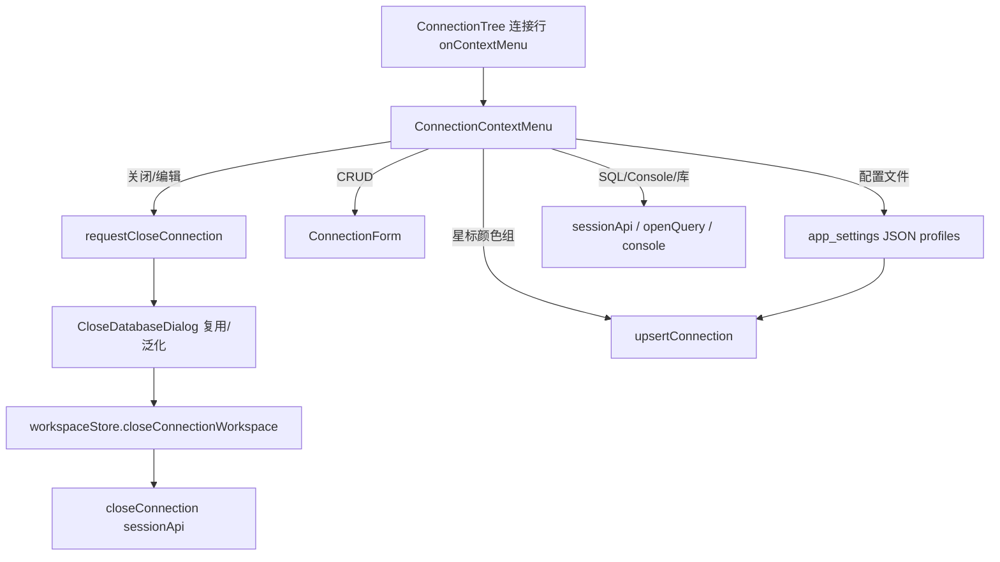

# 设计文档（Design）— 连接节点右键菜单（Navicat 对齐）

> 状态：已完成 2026-11-16
> 关联：[requirements.md](./requirements.md) · [tasks.md](./tasks.md)

## 1. 总体架构

## 2. 关键设计决策

| # | 决策 | 理由 |
|---|---|---|
| D1 | 新建 `ConnectionContextMenu`，镜像 `DatabaseContextMenu` 分区与子菜单交互 | 已有菜单 CSS/子菜单模式，避免在 `ConnectionTree` 内堆 JSX |
| D2 | 新增 `closeConnectionWorkspace(connId)`：关闭该连接下**所有库**的表/查询页签；脏确认复用关库三按钮文案改为「关闭连接」 | 与已实现关库逻辑对称，满足 AC-2.x |
| D3 | 「编辑连接」= `requestCloseConnection(..., after:"edit")` → `ConnectionForm` | 与「编辑数据库」先关后编一致 |
| D4 | 本地配置文件存 `app_settings`：`conn_profiles:{connectionId}` → `{ id, name, host, port, database, user }[]`；切换时 upsert 连接网络字段，不改密码 | 无需新表迁移；满足本地「切换配置文件」 |
| D5 | 「共享…」= 单连接 JSON 下载（复用 export 字段，密码仅 `hasPassword` 标记） | 无云端；可文件传递 |
| D6 | 树列表按 `groupName` 分组渲染（无组在「未分组」）；星标排序保持 meta `ORDER BY starred DESC` | 字段已存在，菜单「管理组」直接写 `groupName` |
| D7 | 颜色条固定 8 色（红橙黄绿青紫灰 + 清除/多色默认），点击即 upsert | 对齐参考图，避免再开系统 color picker |

## 3. 模块与组件

- 新增 [`src/features/nav-tree/ConnectionContextMenu.tsx`](../../src/features/nav-tree/ConnectionContextMenu.tsx) — 完整菜单 UI + 动作回调
- 新增 [`src/features/nav-tree/ManageGroupSubmenu.tsx`](../../src/features/nav-tree/ManageGroupSubmenu.tsx) 或内联子菜单 — 选组/新建组/移出组
- 扩展 [`src/stores/workspaceStore.ts`](../../src/stores/workspaceStore.ts) — `listTabsForConnection` / `closeConnectionWorkspace`
- 扩展 [`src/features/nav-tree/ConnectionTree.tsx`](../../src/features/nav-tree/ConnectionTree.tsx) — `onContextMenu`、分组渲染、`requestCloseConnection`、快捷键绑定到连接级
- 泛化或复制关库对话框为 `CloseWorkspaceDialog`（标题可配「关闭连接」）
- [`src/features/connections/api.ts`](../../src/features/connections/api.ts) + 可选小 API `get/setConnectionProfiles`（若 settings 已有通用 get/set 则复用）
- 后端：若尚无 settings 读写命令，在 [`meta.rs`](../../src-tauri/src/meta.rs) / commands 暴露 `get_setting` / `set_setting`（表 `app_settings` 已存在）

## 4. 数据模型与配置

- 已有：`connections.color` / `starred` / `group_name`
- 新增配置键（无 schema 变更）：`conn_profiles:{id}` JSON 数组
- 复制连接：新 UUID，`name` = `{原名} 副本`，清空 `secretRef` 要求用户填密码（或复制 secretRef 若 vault 支持 clone——优先要求重填密码更安全）

## 5. 数据流（关键场景走查）

1. **关闭连接**：右键 → 收集 `tabs/queryTabs` where `connectionId` → dirty? 对话框 → 保存查询/丢弃 → `closeConnectionWorkspace` → `closeConnection(id)` → 折叠 `expanded`、清 `openDbs` → 若为当前活动连接则 `clearConnection` 或仅清页签保留列表选中策略：活动连接关闭后 `clearConnection`。
2. **切换配置文件**：读 profiles → 选中一项 → `upsertConnection` 更新 host/port/db/user → toast → 可选 `closeConnection`+下次打开重连。
3. **着色**：点击色点 → `upsertConnection({ ...conn fields, color })` → `reload()`。

## 6. 安全考量

- 共享/导出不得写入明文密码；仅 `hasPassword`。
- 复制连接默认不克隆 vault 密码，避免无意扩散凭据。
- SQL 文件在连接级执行：大文件需与库级相同错误 toast，不静默失败。

## 7. 与现有约定的对齐点

- 菜单样式：`dg-context-menu` / `tree-context-menu` / `dg-submenu`
- 脏页签：对齐关库 `CloseDatabaseDialog` 三按钮
- 表单：复用 `ConnectionForm`
- 快捷键：在 `ConnectionTree` 已有 ⌘Y / ⌘R / ⇧⌘. —— ⇧⌘. 在选中库时关库；**无选中库且有活动连接时改为关连接**（或连接菜单关闭始终关连接；库菜单保持关库）
