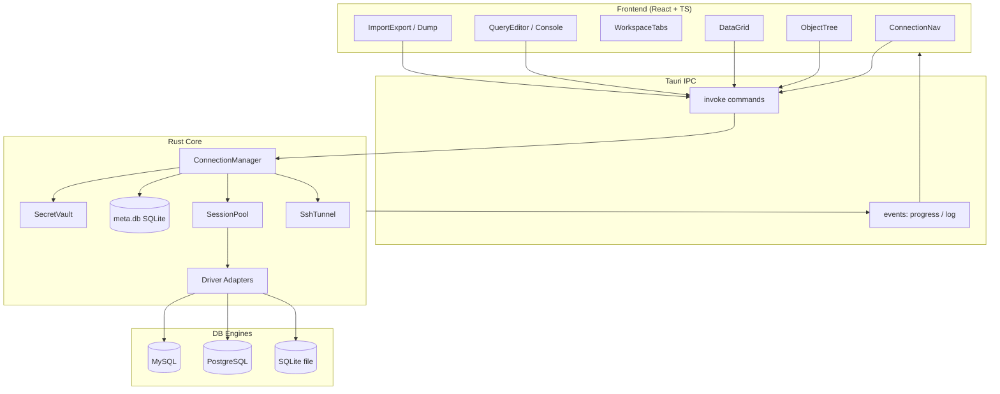

# 设计文档（Design）— My Navicat Phase 0 Desktop MVP

> 状态：已批准 2026-11-16
> 关联：[requirements.md](./requirements.md) · [tasks.md](./tasks.md)

## 1. 总体架构



- UI 只通过 `invoke` / `listen` 访问后端，不直连数据库。
- 所有查询在 Rust 侧异步执行；支持 request-id 取消。
- 失败分支：校验错误 → 返回 `AppError::Validation`；驱动/隧道错误 → `AppError::Driver|Tunnel`；未预期 panic 由边界 catch 并写本地日志。

## 2. 关键设计决策

| # | 决策 | 理由 |
|---|---|---|
| D1 | 采用 **Tauri 2 + React + TS + Rust** | 用户确认默认；相对 Electron 体积更小、Rust 适合驱动与加密；React 利于复杂 IDE 式 UI |
| D2 | **Driver Adapter** trait 统一三引擎 | 满足 PRD 插件化约束；后续加 MariaDB/Mongo 不改 UI 契约 |
| D3 | 元数据用本地 **SQLite `meta.db`**；密钥用 **OS keyring**（`keyring` crate），失败时回退到应用目录 AES-GCM 加密仓 | 满足 AC 凭证非明文；钥匙串在部分 CI/无桌面环境不可用故需回退 |
| D4 | Phase 0 仅 MySQL / PostgreSQL / SQLite | 用户确认默认；控制范围 |
| D5 | 前端状态：**Zustand** + React；表格用虚拟化（如 `@tanstack/react-virtual`） | 简单可替换；保证大结果集 UI 可响应 |
| D6 | SQL 高亮用 **Monaco Editor**（或 CodeMirror 6 若包体积敏感，默认 Monaco） | 满足语法高亮 AC；补全留待 Backlog |
| D7 | SSH 用 Rust **russh**（或 ssh2）做本地端口转发，再连 DB | 满足 SSH Tunnel AC；逻辑集中在 Core |
| D8 | 无遥测、无激活服务；日志仅本地文件 | 满足 AC-8.1 与「闭源可商用骨架但不接激活」约束 |
| D9 | IPC 错误统一 `{ code, message, details? }` | 便于 UI 展示与日志；避免抛生字符串 |
| D10 | 开发期用 Docker Compose 提供 MySQL + PostgreSQL 测试实例；SQLite 用临时文件 | 可重复验证 AC-3.x / 主路径 |

## 3. 模块与组件

建议仓库结构（新建）：

```
my-navicat/
├── package.json                 # 前端工作区 / Tauri scripts
├── src/                         # React UI
│   ├── main.tsx
│   ├── App.tsx                  # 主布局：Nav | Tree | Tabs
│   ├── features/
│   │   ├── connections/         # 连接列表、编辑对话框、分组着色
│   │   ├── object-tree/         # 懒加载对象树
│   │   ├── data-grid/           # 分页/虚拟滚动、编辑提交
│   │   ├── query/               # QueryEditor + Console
│   │   ├── import-export/       # CSV / Dump 向导
│   │   └── settings/            # Dark Mode 等
│   ├── stores/                  # Zustand
│   └── lib/tauri.ts             # 类型化 invoke 封装
├── src-tauri/                   # Rust
│   ├── Cargo.toml
│   ├── tauri.conf.json
│   └── src/
│       ├── main.rs / lib.rs
│       ├── error.rs             # AppError
│       ├── commands/            # Tauri commands 薄封装
│       ├── meta/                # meta.db schema + repos
│       ├── vault/               # keyring + encrypted fallback
│       ├── session/             # ConnectionManager + SessionPool
│       ├── tunnel/              # SSH port-forward
│       └── adapters/
│           ├── mod.rs           # DriverAdapter trait + Object Model
│           ├── mysql.rs
│           ├── postgres.rs
│           └── sqlite.rs
├── docker-compose.yml           # mysql + postgres for local verify
└── README.md
```

**核心 trait（示意）**

- `DriverAdapter::connect(opts) -> Session`
- `Session::list_databases / list_schemas / list_tables`
- `Session::query_page(table, page, sort, filter) -> RowsPage`
- `Session::apply_row_changes(changes) -> Result`
- `Session::execute_sql(sql, cancel_token) -> QueryOutcome`
- `Session::export_csv / import_csv / dump_sql`

## 4. 数据模型与配置

### 4.1 meta.db（应用数据目录）

**connections**

| 字段 | 类型 | 说明 |
|---|---|---|
| id | TEXT PK | UUID |
| name | TEXT | 显示名 |
| engine | TEXT | `mysql` \| `postgres` \| `sqlite` |
| host / port / database / user | TEXT/INT | SQLite 时 host 存文件路径 |
| ssl_mode | TEXT | `disable` \| `require` \| `verify_*`（简化） |
| ssh_enabled + ssh_* | … | 隧道配置（不含密码） |
| color / starred / group_name / hidden | … | 导航展示 |
| secret_ref | TEXT | 指向 Vault 条目 id |
| created_at / updated_at | TEXT | ISO-8601 |

**app_settings**：`key` / `value`（如 `theme=dark`）

**query_drafts**（可选最小实现）：未保存 SQL 草稿，支撑可靠性体验（完整崩溃恢复可列 Backlog）

### 4.2 Vault

- Keyring service：`my-navicat`，account：`conn:{id}:password` / `conn:{id}:ssh_password`
- Fallback 文件：`credentials.enc`（AES-GCM，主密钥由首次启动生成并尽量放入 keyring）

### 4.3 配置

- 默认页大小：`100`（设置可改，上限 1000）
- 日志目录：应用 data dir / `logs/`
- Docker Compose 默认：MySQL `3306`，Postgres `5432`，账号 `navicat/navicat`，库 `demo`

## 5. 数据流（关键场景走查）

### 5.1 测试并打开 MySQL（经 SSH）

1. UI 提交 `connections.test` → Command 读取 Vault 密码 → 若 `ssh_enabled` 则 `SshTunnel::start` 分配本地端口  
2. Adapter 连接 `127.0.0.1:localPort`（或直连 host）+ SSL 选项  
3. 成功：返回 ok；失败：`Tunnel`/`Driver` 错误码 + message  
4. `connections.open` 将 Session 放入 SessionPool，UI 刷新对象树根节点  

### 5.2 编辑并提交 Grid 行

1. `data.fetch_page` 返回列元数据 + rows + total  
2. UI 本地标记 dirty cells / inserted / deleted  
3. `data.commit` 发送变更集；Rust 在事务中执行（SQLite/PG/MySQL InnoDB）  
4. 成功清空 dirty；失败返回错误，UI 保留 dirty 并提示  

### 5.3 执行 SQL 与取消

1. `query.execute` 生成 `job_id`，后台执行  
2. UI listen `query.progress`；用户取消 → `query.cancel(job_id)` 触发 cancel token  
3. 结果经 IPC 回传；超大结果仅返回页或截断并提示导出  

## 6. 安全考量

- 密码不进 `meta.db`、不进导出 JSON 明文；导出走 `secret_ref` 省略或空  
- IPC 仅本地；不暴露无鉴权 HTTP 端口  
- SSL 默认不“盲目信任”；开发开关需显式勾选并警告  
- 失败语义：凭证/隧道 **fail-closed**（不连）  
- 日志默认脱敏（密码、连接串 query 中的 password 字段打码）  
- 无远程遥测（D8）

## 7. 与现有约定的对齐点

- 仓库现为绿场，仅有 `navicat-prd.md`；本设计落实 PRD Phase 0 与 §6 技术建议（Adapter、本地元数据、OS 密钥）  
- 计划文档落在 `.codebuddy/plans/phase0-desktop-mvp/`，与敏捷技能约定一致  
- 命名：产品工作名 **My Navicat**；包名建议 `my-navicat`（可后续品牌化）

## 8. 风险与对策

| 风险 | 对策 |
|---|---|
| keyring 在无 GUI/CI 失败 | AES 回退 + 文档说明 |
| Monaco 包体积大 | 可切 CodeMirror；先默认 Monaco |
| MySQL/PG SSL 证书链差异 | Phase 0 支持 require + 可选危险信任；verify-ca 细节进 Backlog |
| SSH 与取消查询实现复杂 | 先做密码认证 SSH；取消用驱动级 kill query / interrupt，做不到则文档标明限制并保留任务验证“尽力取消” |
| 任务粒度 vs 工作量 | 任务按垂直切片拆分；Docker 辅助可重复验证 |
