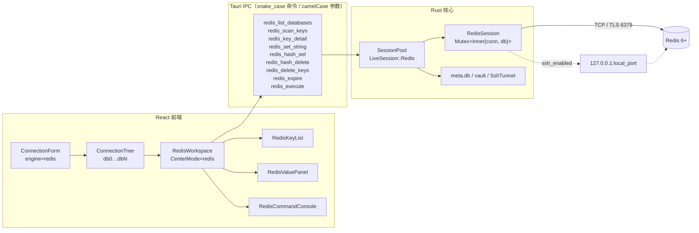

# 设计文档（Design）— Mycat Redis 引擎支持（MVP）

> 状态：已完成 2026-11-24
> 关联：[requirements.md](./requirements.md) · [tasks.md](./tasks.md)

## 1. 总体架构



关键点：

- Redis 不实现 SQL 形状的 `DriverSession` trait，而是作为 `SessionPool` 内的第二种会话类型，与 SQL 会话共享 open/close/幂等复用/隧道生命周期。
- 前端通过独立 `redis_*` 命令访问 Redis；现有 `list_databases` / `execute_sql` 等 SQL 命令对 Redis 连接返回明确错误（「该连接不是 SQL 引擎」），避免误用。
- 连接树只负责「连接 → db 节点」；点击 db 打开系统级 Redis 工作台，键列表/值/命令都在工作台内完成。

## 2. 关键设计决策

| # | 决策 | 理由 |
|---|---|---|
| D1 | Redis 使用独立 `RedisSession`，`LiveSession` 改为 `SessionKind::{Sql(Box<dyn DriverSession>), Redis(RedisSession)}` 枚举，不实现 `DriverSession` | `DriverSession` 的 `list_schemas`/`list_tables`/`query_page`/`apply_row_changes`/`table_ddl` 在 Redis 无对应语义，强行实现会产生 7 个以上桩方法；枚举只改 `session.rs` 内部，SQL 命令零改动 |
| D2 | 使用 `redis = "1.0"`（同步 API，Cargo 实际锁定 1.8.3）+ `tls-native-tls`，复用现有 `native-tls` | 与 MySQL/Postgres 适配器的阻塞式实现一致，不引入 tokio 运行时；`rediss://host:port/db#insecure` 原生支持「信任服务端证书」 |
| D3 | Redis DB 编号复用 `connections.database` 字段，不新增列；后端返回 `"0".."N-1"`，UI 显示为 `db0..dbN-1` | 避免 `meta.db` 迁移；Redis 的 `SELECT index` 与 database 概念天然对应；`database` 在 Redis 连接下不再表示库名 |
| D4 | 键浏览使用 `SCAN cursor MATCH pattern COUNT n`，禁用 `KEYS` | `KEYS` 在大库会阻塞服务端；`SCAN` 增量返回游标，可「加载更多」且不重复 |
| D5 | 值编辑 MVP 仅覆盖 string 与 hash；list/set/zset/stream 只读 | 控制范围与 UI 复杂度；覆盖最常见的缓存修正场景，其余类型先保证可查看 |
| D6 | 命令控制台使用自研 tokenizer（单/双引号、反斜杠转义）后按参数调用 `redis::cmd`，不调用 `redis-cli` 子进程 | 无外部依赖、可单元测试、避免 shell 注入；服务端错误按 `ErrorKind::ResponseError` 作为结果展示而非抛异常 |
| D7 | 前端使用系统级「Redis」页签 + `CenterMode "redis"`，不新增可关闭文档页签类型 | `workspaceStore` 的文档页签带 dirty/关闭确认/恢复逻辑，新增类型牵动 10+ 处；MVP 用 `activeConnection + selectedDatabase` 上下文即可，多页签进 Backlog |
| D8 | 连接树对 Redis 只渲染 db 节点，不渲染表/视图/函数/事件文件夹；点击 db 直接打开工作台 | 复用现有 db 展开/刷新逻辑，改动集中在 `engine === "redis"` 分支；避免 SQL 文件夹对 Redis 产生无意义请求 |
| D9 | 单值超过 256KB 或集合超过 1000 个元素时截断并返回 `truncated: true` | 防止 IPC 大包与 Monaco/表格渲染卡死；用户可用命令控制台按需读取完整数据 |
| D10 | 错误沿用 `Result<T, String>` 扁平字符串 | 与现状一致（`error.rs` 序列化为字符串，command 层 `to_string()`）；不引入未落地的 `{code,message}` 信封 |

## 3. 模块与组件

```text
src-tauri/
├── Cargo.toml                         # + redis 1.0（tls-native-tls）
└── src/
    ├── adapters/
    │   ├── mod.rs                     # + pub mod redis_adapter
    │   └── redis_adapter.rs           # 新增：RedisSession、DTO、URL、tokenizer、reply 转换、单元测试
    ├── commands/
    │   ├── mod.rs                     # + pub mod redis
    │   ├── connections.rs             # validate(): 允许 redis + DB 编号校验
    │   └── redis.rs                   # 新增：9 个 redis_* Tauri 命令
    ├── session.rs                     # LiveSession 枚举化、open/test_connect/can_reuse/cancel 分支、with_redis
    └── lib.rs                         # 注册 redis_* 命令

src/
├── assets/engines/redis.svg           # 新增 Redis 图标
├── features/
│   ├── connections/
│   │   ├── types.ts                   # EngineType + "redis"
│   │   └── ConnectionForm.tsx         # 默认端口 6379、引擎选项、Redis 字段标签与校验
│   ├── nav-tree/
│   │   ├── EngineIcons.tsx            # IconEngineRedis + 分支
│   │   ├── ConnectionTree.tsx         # Redis db 列表/点击打开/隐藏 SQL 文件夹与菜单
│   │   ├── ConnectionContextMenu.tsx  # Redis 隐藏 SQL 专属项，增加「打开 Redis 工作台」
│   │   └── DatabaseContextMenu.tsx    # Redis 不打开（或仅刷新）
│   └── redis/                         # 新增
│       ├── redisApi.ts                # invoke 包装 + 共享类型
│       ├── RedisWorkspace.tsx         # 工作台容器：db/pattern/键列表/详情/控制台
│       ├── RedisKeyList.tsx           # 键表：多选、类型、TTL、大小、加载更多
│       ├── RedisValuePanel.tsx        # 按类型查看/编辑、TTL、删除
│       └── RedisCommandConsole.tsx    # 命令输入、历史、回复渲染
├── stores/workspaceStore.ts           # CenterMode + "redis"、openRedis()
├── shell/MainWorkspace.tsx            # 条件系统页签「Redis」+ 内容分支
└── styles/features.css                # .redis-* 样式

docker-compose.yml                     # + redis 服务（6380:6379，密码 navicat）
docs/redis-smoke.md                    # 新增手工烟测清单
README.md                              # 引擎列表、Docker 表、烟测入口
```

关键类型/函数：

- `RedisSession::{connect, ping, list_databases, scan_keys, key_detail, set_string, hash_set, hash_delete, delete_keys, expire, execute}`。
- `SessionPool::{with_redis, is_redis}`；`LiveSession { kind: SessionKind, _tunnel: Option<SshTunnel> }`。
- `tokenize_command(&str) -> AppResult<Vec<String>>`、`value_to_reply(&redis::Value) -> RedisReply`、`build_redis_url(&ConnectOpts) -> AppResult<String>`。
- 前端 `openRedis({ connection?, database? })`；`RedisWorkspace` 读取 `activeConnection` / `selectedDatabase`。

## 4. 数据模型与配置

### 4.1 连接档案（无表结构变更）

| 字段 | Redis 语义 |
|---|---|
| `engine` | `"redis"` |
| `host` / `port` | 主机 / 端口（默认 6379） |
| `database` | DB 编号字符串 `"0"`–`"255"`，空值按 `"0"` 处理 |
| `user` | 可选 ACL 用户名；空表示 `default` 用户 |
| `secret_ref` | 指向 vault 中的密码；SSH 密码仍为 `"{secret_ref}:ssh"` |
| `ssl_mode` | `disable` / `require`（require → `rediss://`） |
| `ssl_trust` | `true` 时 URL 追加 `#insecure`（跳过证书校验） |
| `ssh_*` | 复用现有 SSH 隧道字段 |

### 4.2 IPC DTO（Rust `#[serde(rename_all = "camelCase")]`）

| 类型 | 字段 |
|---|---|
| `RedisKeyMeta` | `key: String`、`kind: String`、`ttl: i64`（-1 永久 / -2 不存在）、`size: Option<i64>` |
| `RedisKeyPage` | `cursor: u64`、`keys: Vec<RedisKeyMeta>`、`scanned: i64` |
| `RedisKeyValue` | `key`、`kind`、`ttl: i64`、`size: Option<i64>`、`truncated: bool`、`value: serde_json::Value` |
| `RedisReply` | `kind: String`（status/integer/bulk/array/nil/error）、`text: String`、`value: serde_json::Value`、`truncated: bool` |

`RedisKeyValue.value` 按类型约定：

- string：JSON 字符串
- hash：`[{ "field": "...", "value": "..." }]`
- list / set：`["..."]`
- zset：`[{ "member": "...", "score": 1.0 }]`
- stream：`[{ "id": "...", "fields": [{ "field": "...", "value": "..." }] }]`

### 4.3 Tauri 命令

| 命令 | 参数 | 返回 |
|---|---|---|
| `redis_list_databases` | `connectionId` | `Vec<String>`（`"0".."N-1"`） |
| `redis_scan_keys` | `connectionId, db, pattern, cursor, count?` | `RedisKeyPage` |
| `redis_key_detail` | `connectionId, db, key` | `RedisKeyValue` |
| `redis_set_string` | `connectionId, db, key, value, ttl?` | `()` |
| `redis_hash_set` | `connectionId, db, key, field, value` | `()` |
| `redis_hash_delete` | `connectionId, db, key, fields` | `i64` |
| `redis_delete_keys` | `connectionId, db, keys` | `i64` |
| `redis_expire` | `connectionId, db, key, ttlSecs?` | `bool` |
| `redis_execute` | `connectionId, db, command` | `RedisReply` |

所有命令内部流程：`pool.with_redis(connection_id, |s| { s.select_db(db)?; ... })`。

### 4.4 配置

- `docker-compose.yml` 新增 `redis`：镜像 `redis:8-alpine`（Redis 8，兼容 6+ 命令），`--requirepass navicat`，端口 `6380:6379`（避开本机 6379），healthcheck `redis-cli -a navicat ping`。
- 集成测试环境变量：`MYCAT_REDIS_TEST=1`、`MYCAT_REDIS_HOST`（默认 `127.0.0.1`）、`MYCAT_REDIS_PORT`（默认 `6380`）、`MYCAT_REDIS_PASSWORD`（默认 `navicat`）、`MYCAT_REDIS_DB`（默认 `15`）。未设置 `MYCAT_REDIS_TEST` 时测试直接返回，不失败。

## 5. 数据流（关键场景走查）

### 5.1 新建并打开 Redis 连接

1. `ConnectionForm` 选择 Redis → 端口自动 6379，DB 编号默认 0；提交前校验主机/端口/DB 编号。
2. `upsert_connection` → `validate()` 允许 `redis`，密码写入 vault，元数据写入 `meta.db`。
3. 连接树展开 → `open_connection` → `SessionPool::open` 解析 `ConnectOpts`；若 `ssh_enabled`，`resolve_with_tunnel` 建隧道并把 host/port 改写为 `127.0.0.1:local_port`（默认远端 6379）。
4. `RedisSession::connect` 拼 URL（`redis://` 或 `rediss://`，含 ACL/密码/DB/#insecure），`get_connection_with_timeout(5s)` 完成 AUTH/SELECT，再 `PING`。
5. `redis_list_databases` 执行 `CONFIG GET databases`；成功取 N，失败回退 16；返回 `"0".."N-1"`，树显示 `db0..dbN-1`。
6. 失败分支：认证失败/超时/端口错误 → command 返回字符串错误，树节点显示错误并保留展开状态。

### 5.2 浏览键并加载更多

1. 点击 db 节点 → `openRedis({connection, database})` → `centerMode="redis"`，工作台挂载。
2. `redis_scan_keys(db, pattern="*", cursor=0, count=200)` → `SCAN 0 MATCH * COUNT 200`。
3. 对返回的键用 pipeline 批量取 `TYPE` / `TTL` / `MEMORY USAGE`，组装 `RedisKeyMeta`；`MEMORY USAGE` 失败时 `size=null`。
4. 前端按 key 去重后追加；`cursor != 0` 时显示「加载更多」；点击后以该 cursor 继续。
5. 修改 pattern → 清空列表与 cursor，重新从 0 扫描；错误 → 保留已加载结果并在面板内显示错误。

### 5.3 查看/编辑 string 与 hash

1. 选中键 → `redis_key_detail`：`TYPE` 为 `none` 时返回「键不存在」错误；否则按类型读取值（string `GET`、hash `HGETALL`、list `LRANGE 0 999`、set `SMEMBERS`、zset `ZRANGE 0 999 WITHSCORES`、stream `XRANGE - + COUNT 100`）。
2. 超过 256KB/1000 元素 → 截断并 `truncated=true`，前端显示「已截断」。
3. string 保存 → `redis_set_string`：`ttl` 未传时 `SET key value KEEPTTL`；`ttl>0` 时 `SET key value EX n`；`ttl<=0` 时 `SET key value`（永久）。
4. hash 保存 → `HSET key field value`；删除字段 → `HDEL`。
5. 删除键 → 前端二次确认 → `DEL`；TTL → `EXPIRE` / `PERSIST`。
6. 键不存在/类型变化 → 后端返回明确错误，前端提示并触发键列表刷新。

### 5.4 执行命令

1. 前端把输入交给 `redis_execute`；后端 tokenizer 解析（空/引号未闭合 → 本地错误，不发送）。
2. `SELECT db`（与当前会话 db 不同才发送）→ `redis::cmd(cmd).arg(args).query::<redis::Value>()`。
3. `ErrorKind::ResponseError` → 返回 `RedisReply{kind:"error", text: 原文}`（HTTP 层仍为 Ok）；IO/协议错误 → command 返回 Err。
4. 回复递归转 JSON，数组/集合最多 1000 项；前端按 kind 渲染，数组用缩进 JSON。
5. ↑/↓ 在本地历史数组中移动，不持久化。

## 6. 安全考量

- **凭证**：Redis 密码只进 vault（AES-256-GCM），`list_connections` 只返回 `hasPassword`，导出连接不含密码；URL 仅在内存中构造，不写日志。
- **TLS**：默认校验证书；`ssl_trust=true` 才追加 `#insecure`，UI 标注「危险，仅开发」；fail-closed 为默认。
- **命令控制台**：等价于当前连接权限的原生命令通道，不额外提权；不经过 shell，无命令注入面；UI 提示「命令以当前连接权限执行」。
- **资源保护**：`SCAN COUNT` 上限 1000；值/回复截断上限 256KB / 1000 元素；连接超时 5 秒，读写超时 30 秒，避免 UI 无限等待。
- **数据留存**：不在本地缓存键值；关闭连接即释放；不写入日志。
- **误操作隔离**：Redis 连接隐藏 SQL 专属入口（新建数据库/运行 SQL 文件/转储 SQL/表设计器），避免对 Redis 发送 SQL。

## 7. 与现有约定的对齐点

- 命令名 snake_case、参数 camelCase、DTO `#[serde(rename_all = "camelCase")]`，与 `commands/session.rs` 一致。
- 错误仍为 `Result<T, String>`；前端统一 `err instanceof Error ? err.message : String(err)`。
- 复用 `SessionPool` 的「每连接独立锁」模型：慢 Redis 命令只阻塞同一连接。
- 复用 `vault` / `meta.db` / `tunnel`，不新增存储与依赖管理方式。
- 前端不新增依赖；CSS 使用 `features.css` 的 kebab-case 类名与 `var(--bg-elevated)` 等主题变量；文案简体中文。
- 测试沿用内联 `#[cfg(test)] mod tests`；集成测试用环境变量开关，缺省跳过。

## 8. 风险与对策

| 风险 | 对策 |
|---|---|
| `redis` crate 1.0 的 TLS/URL 行为与预期不符 | 已确认 `rediss://…#insecure` 与 `tls-native-tls` 特性；实现时先写 URL/连接单元测试，编译失败则回退为「仅系统信任证书」并在 UI 禁用 `ssl_trust` |
| 托管 Redis 禁用 `CONFIG GET databases` / `MEMORY USAGE` | 分别回退 16 个库 / `size=null`，不阻塞主路径 |
| `SCAN` 可能返回重复键 | 前端按 key 去重后再追加 |
| 大 key / 大集合导致 IPC 卡顿 | 截断 + `truncated` 标记；完整数据走命令控制台 |
| Redis 6 以下不支持 `KEEPTTL` | 需求约束 Redis 6+；错误原文透出，用户可改用命令控制台 |
| 系统级 Redis 页签在切换连接后上下文错位 | `RedisWorkspace` 校验 `activeConnection.engine === "redis"`，否则显示「请选择 Redis 连接」占位 |
| 二进制键值显示乱码 | 按 UTF-8 lossy 展示并在 UI 标注「非文本内容可能显示为替换字符」；二进制安全编辑进 Backlog |
