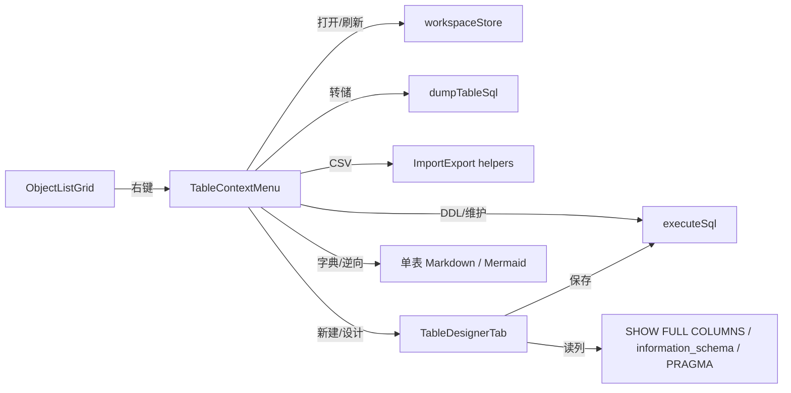

# 设计文档（Design）— 表右键菜单对齐 Navicat（MVP）

> 状态：已完成 2026-11-16
> 关联：[requirements.md](./requirements.md) · [tasks.md](./tasks.md)

## 1. 总体架构



入口仍为对象列表右键（[`ObjectListGrid.tsx`](../../../src/features/object-list/ObjectListGrid.tsx)）；不改导航树结构。

## 2. 关键设计决策

| # | 决策 | 理由 |
|---|---|---|
| D1 | 菜单壳一次对齐参考图；未实现项禁用+「稍后」 | 满足视觉对齐且不假装功能完成（AC-1.3） |
| D2 | 表级转储/字典/逆向从 `DatabaseContextMenu` 抽共享 helper，菜单调用单表版 | 避免复制粘贴大段逻辑；库菜单可后续改调同一 helper |
| D3 | 「导入/导出向导」本迭代 = 一步 CSV（触发文件选择 / 下载），不新建多步 Wizard 框架 | 范围收敛；真正向导进 Backlog |
| D4 | 新建/设计表用新 centerMode 页签 `table-designer`，列网格编辑 + 预览 SQL + 应用 | 取代「打开查询看结构」作为主路径；查询捷径可保留为次要 |
| D5 | DDL 由前端按引擎生成，经现有 `executeSql` 执行；不新增 design IPC | 与既有 session 模式一致；失败可展示服务端错误 |
| D6 | 复制表：MySQL `CREATE TABLE new LIKE old` + 可选 `INSERT SELECT`；PG/SQLite 走「结构 dump → 改名 → 执行」(+ 可选数据页拷贝) | LIKE 是 MySQL 专有；其它引擎用已有 dump 能力 |
| D7 | 维护子菜单仅对 MySQL 启用 Analyze/Optimize/Check/Repair；PG 仅 Analyze；SQLite 隐藏或禁用 | 语句因引擎而异，避免乱发 SQL |
| D8 | 快捷键在对象列表聚焦且无输入框焦点时由 `ObjectListGrid`/窗口级监听 | 与连接菜单 ⌘Y/⌘R 模式一致 |

## 3. 模块与组件

```
src/features/nav-tree/TableContextMenu.tsx     # 菜单分区 + 动作接线
src/features/nav-tree/tableMenuActions.ts      # 单表 dump/字典/逆向/复制表/维护（新建）
src/features/table-designer/TableDesigner.tsx  # 可视化设计器页签 UI（新建）
src/features/table-designer/ddl.ts             # 列模型 → CREATE/ALTER SQL（新建）
src/features/table-designer/loadColumns.ts     # 按引擎拉取列元数据（新建）
src/features/object-list/ObjectListGrid.tsx     # 快捷键 + 刷新接线
src/stores/workspaceStore.ts                   # openTableDesigner / tab kind
src/features/import-export/*                   # 供菜单调用的函数导出（小改）
src/App.css                                    # 设计器样式（克制复用现有）
```

## 4. 数据模型与配置

设计器列行模型（前端）：

```ts
type DesignerColumn = {
  name: string;
  rawType: string;      // e.g. varchar(255), int, datetime
  nullable: boolean;
  isPk: boolean;
  defaultValue: string | null;
  comment?: string;
  /** 已存在列的原始名；新建列为 null */
  originalName?: string | null;
};
```

工作区 Tab：`kind: "table-designer"`，字段含 `connectionId` / `database` / `table`（新建可为空占位名）/ `mode: "create" | "alter"`。

无 meta.db schema 变更。

## 5. 数据流（关键场景走查）

### 5.1 设计已有表并保存

1. 右键 → 设计表 → `openTableDesigner({ mode:"alter", table })`
2. `loadColumns`：MySQL `SHOW FULL COLUMNS FROM db.table`；PG `information_schema.columns`；SQLite `PRAGMA table_info`
3. 用户改列 → 预览 ALTER（rename/modify/add/drop 按引擎模板）
4. 应用 → `openConnection` + `executeSql` 逐条或批量 → 成功 toast + `onRefresh`；失败 setError

### 5.2 复制表（结构+数据，MySQL）

1. 子菜单 → 输入新表名 → 校验标识符
2. `CREATE TABLE db.new LIKE db.old` → `INSERT INTO db.new SELECT * FROM db.old`
3. 刷新对象列表

### 5.3 转储单表

1. 子菜单 → `dumpTableSql({ connectionId, table, database, includeData, engine })` → `downloadTextFile`

## 6. 安全考量

- 所有用户输入的表名/列名经标识符白名单（字母数字下划线）或严格转义；禁止拼进 SQL 注入。
- 删除/清空/截断/Repair 需确认；Repair/Optimize 仅 MySQL 且明确提示锁表风险。
- 导入 CSV 仍受现有列映射校验约束。

## 7. 与现有约定的对齐点

- 菜单 class：`dg-context-menu conn-context-menu` + `dg-menu-sep` / submenu（对齐连接菜单）。
- Toast：`onMessage` → ObjectListGrid toast。
- 引擎分支：`String(conn.engine)`，与 DataGrid / QueryEditor 一致。
- Dump IPC：已支持 `database` 参数（1046 修复后）。

## 8. 风险与对策

| 风险 | 对策 |
|------|------|
| PG/SQLite ALTER 能力弱（改类型困难） | 设计器对不支持的变更禁用或提示「请用 SQL」；MySQL 为完整主路径 |
| 大表复制数据超时 | 复制时 toast 进度；失败展示错误；后续可改分批 INSERT |
| 设计器范围膨胀 | 本迭代不做索引/外键；Backlog 明确 |
